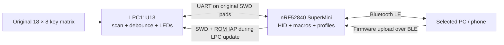

# Lenovo K800 Wireless Keyboard

**Convert a Lenovo K800 / Y Gaming Mechanical Switch Keyboard to Bluetooth LE with an nRF52840 SuperMini, while keeping its original key matrix and LPC11U13 controller.**

This project provides replacement firmware for both controllers. The LPC scans the keyboard and controls its LEDs; the nRF handles Bluetooth HID, macros, host profiles, power management, and wireless firmware updates. No Lenovo desktop application is required.

It also includes an **adaptive key chatter fix**: per-key debouncing intended to suppress unintended double key presses. *Key chatter* or *switch chatter* is the usual keyboard term for this problem, sometimes searched for as a “double click fix.” See [debouncing](docs/debouncing.md) for the algorithm and its limits.

This is an independent hardware modification, not an official Lenovo product or a ZMK/QMK port. It targets the LPC11U13 board identified as USB `17ef:6082`; check your PCB before using the pin map.

## Features

- Bluetooth LE HID: six ordinary keys plus eight modifiers, with a separate media report.
- Three simultaneous BLE connections; double-tap **M1, M2, or M3** to select the host receiving input.
- Three banks of **G1–G6** macros, recorded with **MR** and stored on the nRF.
- Two backlight controls, five brightness levels, and an additional **all LEDs off** mode.
- Sleep and wake using the original **crossed-out Windows** button, without another button wire.
- LPC power cutoff and slower BLE advertising when all hosts disconnect.
- Updates from a PC over BLE for **both nRF52840 and LPC11U13**.
- A 115200-baud inter-controller link and a requested 7.5 ms active BLE interval.
- Adaptive release debouncing from 5 to 60 ms, while press confirmation stays at 5 ms.

## How it works



The replacement LPC firmware starts at address zero. **It replaces the original USB keyboard firmware and factory updater.** Keep your own complete original Flash backup before flashing. The nRF USB port is used for installation and recovery; this application sends keyboard input over BLE.

## Hardware and wiring

Required: a compatible Lenovo K800 keyboard with LPC11U13, an nRF52840 SuperMini with a compatible nice!nano bootloader, a 1 kΩ resistor, wire, soldering equipment, and a way to back up/recover the LPC over SWD. An ST-Link or another supported SWD probe is useful for the initial backup.

The table uses **Nordic GPIO numbers**, not physical pad numbers or Pro Micro pin labels. These are connections to the **LPC's** SWD pads, not to the nRF's debug port.

| Keyboard PCB / LPC | SuperMini connection | Normal operation |
|---|---|---|
| SWDIO / `PIO0_15` | **1 kΩ in series** to `P0.08` | LPC TX → nRF RX; also wake signal |
| SWCLK / `PIO0_10` | `P0.11` | nRF TX → LPC RX |
| RESET | `P0.17` | Open-drain reset; pull-up to LPC's supply |
| GND | GND | Common ground |
| LPC 3.3 V supply | Switched VCC/3V3 output, enabled by `P0.13 = HIGH` | Off when disconnected; retained during manual sleep |

**Read [the wiring and power guide](docs/hardware.md) before connecting power.** GPIO P0.13 is the firmware's power-control signal; identify the actual supply rail and switching circuit on your board. SuperMini revisions and nice!nano generations can differ. Do not connect USB 5 V or a raw Li-ion cell to LPC VDD, and do not tie two power sources together.

The LPC keeps SWD available for three seconds after reset, then reuses the two signal pads for UART. Disconnect an external SWD probe during normal operation. Release any BOOT/ISP strap on LPC `PIO0_1` before running the application.

## Build

The documented development environment is Linux with Python 3.10+, PlatformIO, an ARM GNU toolchain, and `g++` for host tests. The PC updater uses Bleak; Windows/macOS support is provided by that library but has not been hardware-tested here.

```sh
git clone https://github.com/bve/lenovo-k800-wireless.git
cd lenovo-k800-wireless
python3 -m venv .venv
.venv/bin/python -m pip install -r tools/requirements-dev.txt

# Install the pinned PlatformIO platform/framework/toolchain and build nRF.
.venv/bin/pio run -e supermini_ble
.venv/bin/python tools/build_lpc.py
.venv/bin/python tools/package_nrf.py
.venv/bin/python tools/verify_artifacts.py
```

Builds use the checked-in matrix layout. **No factory firmware dump is needed to build or test.** Optional reverse-engineering tools accept your own matching dump explicitly.

| Artifact | Purpose |
|---|---|
| `build/lpc11u13/keyboard.bin` | LPC application, Flash address `0x00000000` |
| `build/lpc11u13/keyboard.elf` | LPC application with debug symbols |
| `build/nrf52840/keyboard_s140_7.3.0.uf2` | nRF application only, address `0x00027000` |
| `.pio/build/supermini_ble/firmware.zip` | nRF application update over BLE |

The nRF application requires **S140 7.3.0** and the compatible **Adafruit 0.11.0-keyboard1** bootloader described below. The SoftDevice and bootloader have separate version numbers. A normal application UF2 does not install either component.

## First installation

1. Identify the keyboard PCB, back up its full 24 KiB LPC Flash, and check the power arrangement in [hardware.md](docs/hardware.md).
2. Build and install the compatible nRF bootloader and S140/application using the [first-install instructions](docs/ble_updates.md#first-installation-over-usb).
3. With power disconnected, wire the controllers as shown above. Remove the LPC ISP strap and disconnect the external programmer.
4. Power the assembly and pair **Lenovo BLE Keyboard** in the host's Bluetooth settings.
5. Run the BLE `lpc` command below. The nRF programs LPC through SWD and verifies its complete Flash. Wait through the LPC's three-second recovery window after reset.
6. Run `status`; confirm a live UART link, command acknowledgements, and the selected BLE profile. Test ordinary keys before testing macros, lighting, and sleep.

## Wireless updates

Wake the keyboard first. Pair through the operating system, scan for its address, and replace `YOUR_KEYBOARD_ADDRESS` below with the discovered address or OS device UUID.

```sh
.venv/bin/python tools/ble_update.py scan
.venv/bin/python tools/ble_update.py status --address YOUR_KEYBOARD_ADDRESS

.venv/bin/python tools/build_lpc.py
.venv/bin/python tools/ble_update.py lpc --address YOUR_KEYBOARD_ADDRESS \
  build/lpc11u13/keyboard.bin

.venv/bin/pio run -e supermini_ble
.venv/bin/python tools/ble_update.py nrf --address YOUR_KEYBOARD_ADDRESS \
  .pio/build/supermini_ble/firmware.zip
```

VS Code: **Terminal → Run Task… → Keyboard: flash LPC over BLE** or **Keyboard: flash nRF over BLE**. Each task builds first and asks for your keyboard's address. Updates run one at a time. See [BLE updates and recovery](docs/ble_updates.md) for prerequisites, status fields, interrupted transfers, and USB recovery.

## Keyboard controls

| Action | Result |
|---|---|
| Press M1 / M2 / M3 once | Select a bank of six macros |
| Double-tap M1 / M2 / M3 | Also select BLE host profile 1 / 2 / 3 |
| MR → G1–G6 → type → MR | Record a macro in the selected bank |
| MR → G1–G6 → MR | Clear that macro and restore its default key |
| Either backlight button | Cycle its group: **4 → 3 → 2 → 1 → 0 → 5 → 4** |
| Backlight mode 5 | Turn off both groups and every indicator, including Num/Caps/Scroll |
| Press and release crossed-out Windows | Sleep; press it again to wake |

Unassigned G1–G5 produce digits 1–5; G6 produces F15. The M LEDs indicate the **macro bank**, which can differ from the selected BLE profile. Recording also sends keys to the active application.

Read [macros and lighting](docs/factory_controls.md), [Bluetooth profiles](docs/bluetooth_profiles.md), and [sleep and power](docs/sleep.md) for exact behavior.

## Validation and limitations

Hardware checks on the development keyboard have confirmed BLE typing, MR recording/playback, lighting commands, full LPC Flash verification, nRF BLE self-update, and two button sleep/wake cycles. A 7.5 ms BLE interval and 115200 UART were observed on a Linux/Intel BE200 host.

The adaptive filter passes synthetic chatter and training tests. Physical suppression of the reported faulty switches after the latest adaptive update has **not yet been confirmed**. Three simultaneous physical hosts, every matrix position/media key, complex combinations, battery runtime, and sleep current still need hardware validation. The host chooses the actual BLE interval; end-to-end physical key latency has not been measured.

This firmware provides 6KRO plus modifiers, not Lenovo's extra multi-key report. A battery/charger installation and a measured power budget are not included. Firmware updates use CRC for integrity, not signed-image authentication or rollback protection.

```sh
.venv/bin/python tools/run_tests.py
```

Host tests cover debounce, matrix mapping, packet recovery, macros, lighting, profile routing, sleep, SWD/IAP programming, and BLE update ownership/error handling. CI also builds both firmware images. See [testing](docs/testing.md) and [architecture](docs/architecture.md).

## Project layout

- `firmware/lpc11u13/`: standalone Cortex-M0 scanner, LEDs, UART, and wake support.
- `firmware/nrf52840/`: BLE HID, profiles, storage, SWD programmer, and DFU handover.
- `include/bridge/`: transport, layout, debounce, and shared state machines.
- `tools/`: build, packaging, host BLE updater, and optional analysis utilities.
- `tests/`: host-side C++ and Python tests, including transport fakes.
- `analysis/`: reverse-engineering notes and recovered hardware tables.
- `patches/bootloader/`: reproducible Adafruit bootloader compatibility patch.

## License and credits

Project code and documentation are [MIT licensed](LICENSE), except files carrying their own notices. The Adafruit-derived DFU handover retains its BSD-3-Clause notice. External frameworks, bootloader sources, and Nordic SoftDevice retain their upstream licenses; see [THIRD_PARTY_NOTICES.md](THIRD_PARTY_NOTICES.md).

Factory firmware, vendor installers, full device dumps, personal logs, and generated build products are not distributed in this repository. Lenovo, Nordic Semiconductor, Adafruit, and nice!nano names identify the hardware/software used; this project is not affiliated with their owners.

**Keywords:** Lenovo K800, Lenovo Y Gaming Mechanical Switch Keyboard, nRF52840, SuperMini, wireless keyboard conversion, Bluetooth LE keyboard, key chatter fix, adaptive debounce, double key press fix.
